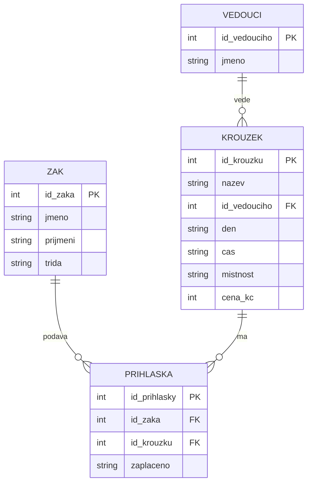

# SP1 Kroužky

Kód žáka: IT2-04

## Problémy původní tabulky

1. **Opakování:** jméno žáka, třída i údaje o kroužku (vedoucí, den, čas, místnost, cena) se píšou znovu na každém řádku. Když se změní třeba místnost Robotiky, musím ji přepsat na třech místech a jedno snadno zapomenu.
2. **Pokaždé jinak:** Robotika je jednou „Robotika“, jednou „robotika “ s mezerou a jednou „ROBOTIKA“, vedoucí je „Mgr. Horák“, „Horák“ a „Horak“, cena je někdy „450 Kč“ a jindy „450“, den „čt“ i „čtvrtek“, čas „14:00“ i „14.00“. Počítač to bere jako různé věci.
3. **Nejde odpovědět na otázky:** kolik kroužků škola nabízí, nebo kolik se vybralo na cenách, z tabulky spolehlivě nespočítám, protože názvy a ceny jsou zapsané různě. Navíc u dvou přihlášek chybí údaj o zaplacení, takže nevím, jestli je žák zaplatil.

## Tabulky a klíče

- zaci: PK id_zaka
- krouzky: PK id_krouzku, FK id_vedouciho → vedouci
- vedouci: PK id_vedouciho
- prihlasky: PK id_prihlasky, FK id_zaka → zaci, FK id_krouzku → krouzky

## ER diagram



## SQL

```sql
SELECT nazev, cena_kc
FROM krouzky
WHERE cena_kc > 500;
```

Žáci, kteří ještě nezaplatili:

```sql
SELECT z.jmeno, z.prijmeni, k.nazev
FROM prihlasky p
JOIN zaci z ON z.id_zaka = p.id_zaka
JOIN krouzky k ON k.id_krouzku = p.id_krouzku
WHERE p.zaplaceno = 'ne' OR p.zaplaceno IS NULL;
```

## CREATE TABLE

```sql
CREATE TABLE zaci (id_zaka INTEGER PRIMARY KEY, jmeno TEXT, prijmeni TEXT, trida TEXT);
CREATE TABLE vedouci (id_vedouciho INTEGER PRIMARY KEY, jmeno TEXT);
CREATE TABLE krouzky (id_krouzku INTEGER PRIMARY KEY, nazev TEXT, id_vedouciho INTEGER REFERENCES vedouci(id_vedouciho), den TEXT, cas TEXT, mistnost TEXT, cena_kc INTEGER);
CREATE TABLE prihlasky (id_prihlasky INTEGER PRIMARY KEY, id_zaka INTEGER REFERENCES zaci(id_zaka), id_krouzku INTEGER REFERENCES krouzky(id_krouzku), zaplaceno TEXT);
```
